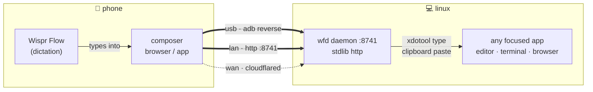

<div align="center">

# ✳ Wispr Wrap

**there is no Wispr Flow for Linux — so the phone becomes the mic.**

dictate on your phone → it types wherever your cursor is.<br>
text · images · videos · files — over **USB**, **Wi-Fi**, or **anywhere**.

`stdlib python · zero deps · ~20MB RSS · no build step`

</div>



## run it

```bash
git clone https://github.com/GC-WORK11/wispr-wrap
cd wispr-wrap
npm install        # zero dependencies — instant
npm run wrap       # daemon + pairing QR/link

# optional — a real `wrap` on your PATH:
npm link           # then just: wrap / wrap pair / wrap tunnel …
```

a QR + link print instantly:

```
  ▄▄▄▄▄▄▄▄▄▄▄▄▄▄▄▄▄
  █ ▄▄▄▄▄ █▀█▀▄ ▄ █
  █ █   █ █▄ ▄█▄▄█ █
  █ ▀▀▀▀▀ █ ▀ ▀ ▀ █
  ▀▀▀▀▀▀▀▀▀▀▀▀▀▀▀▀▀

  scan with your phone camera — composer opens paired
  or open on phone:  http://<lan-ip>:8741/?k=…
```

**scan → composer opens → dictate → send.** that's the whole setup.

> phone can't reach the link? if `ufw` is on: `sudo ufw allow 8741/tcp`

## use it

| do this | get this |
|---|---|
| tap the field, dictate with **Wispr Flow** → **↑** | text types at your laptop cursor |
| type manually → **↑** | same — works without Wispr |
| **+** → pick photo/video → **↑** | lands on the laptop clipboard, already pasted |
| attach a file → **↑** | saved to `~/wf-uploads`, path pasted |

## three ways to connect

| mode | how | reach |
|---|---|---|
| **usb** | `wrap bridge` after plug-in — the app auto-pairs, no screen, no QR | wired, zero network |
| **lan** | scan the QR on the same wi-fi | room-scale |
| **wan** | `wrap tunnel` → cloudflare quick tunnel + QR | anywhere on earth |

the pairing key lives at `~/.config/wf/key` (mode 600) and rotates whenever you want — delete it, `wrap restart`, done.

## commands

```
wrap start     daemon + pair QR          wrap doctor   verify dependencies
wrap pair      show QR / session code    wrap status   daemon·adb·bridge·tunnel
wrap bridge    adb reverse (usb mode)    wrap send hi  type "hi" at the cursor
wrap tunnel    cloudflare tunnel + QR    wrap stop     shut it all down
wrap install   build + install the apk   wrap open     launch the app
```

## requirements

- **linux/x11** — `python3`, `curl`, `xdotool`, `xclip`, `xprop`, imagemagick, `python3-xlib`
- **phone** — any modern browser. android 8+ for the optional app
- **optional** — `adb` (usb mode), `cloudflared` (wan mode), `scrcpy` (mirroring)
- `wrap doctor` checks all of it — run it first

## security model

- `/send*` endpoints require `X-WF-Key` — constant-time compare
- `/pair-info` is **localhost-only** *and* rejects proxied requests — the key can't leak through a tunnel
- `/pair` (8-char session code) is rate-limited to 1 try/sec/IP
- LAN traffic is authenticated HTTP — encrypted only when you opt into `wrap tunnel`
- set `WF_NO_LOG_TEXT=1` to keep dictated text out of `wfd.log`

## layout

```
bin/wrap      the CLI                    web/       the composer (pure html/js)
server/wfd.py daemon + x11 injection     app/       android shell, gradle-free build
server/wfclip.py multi-target clipboard  server/qrcodegen.py  vendored qr (nayuki, mit)
```

---

*unofficial bridge — not affiliated with Wispr. built because linux deserved it.* ✳
