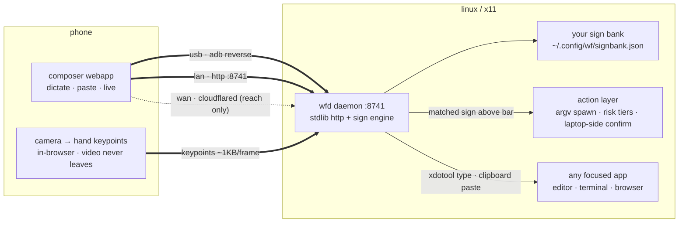
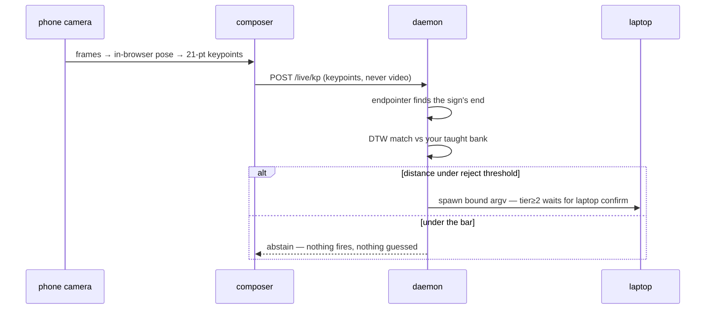

<div align="center">

# ✳ Wispr Wrap

**there is no Wispr Flow for Linux — so the phone becomes the mic. and the hands.**

dictate, paste, or *sign* on your phone → it types at your cursor or runs an action.<br>
text · images · videos · files · **taught sign control** — over **USB**, **Wi-Fi**, or **anywhere**.

`stdlib python · zero deps · ~20MB RSS · no build step · offline`

</div>

## what it is

a private input layer for your laptop. two lanes, one composer:

- **composer** *(ships today)* — dictate or type on your phone, it lands wherever
  your linux cursor is. attach a photo, video, or file and it's pasted into the
  focused app. no account, no cloud, nothing leaves your lan unless you tunnel it.
- **live** *(landing on `devin/live-merge`)* — hold your palm to the phone camera
  and your laptop listens. teach it *your* signs — a flick for "open browser", a
  tap for "screenshot" — and signing runs the bound action. teach-by-example, not
  a fixed sign language: 1–3 takes, ~90 s a sign, no gpu. video never leaves the
  phone; the browser sends keypoints only.

> merging with [Sign-Flow](https://github.com/GC-WORK11/sign-flow) (pose →
> keypoints, teach-by-example DTW bank, risk-tiered action layer). the sign-to-
> *text* CTC engine stays as the advanced lane — it needs a per-user gpu
> enrollment, which is exactly why the judge-facing surface is sign-to-**control**.
> product name tbd — proposals in [docs/JUDGE_PATH.md](docs/JUDGE_PATH.md).





## run it

```bash
git clone https://github.com/GC-WORK11/wispr-wrap
cd wispr-wrap
npm install        # zero dependencies — instant
npm run wrap       # daemon + pairing QR/link

# no node? ./bin/wrap start is the same thing.
# optional — a real `wrap` on your PATH:
npm link
```

a QR + link print instantly — scan → composer opens paired → dictate → send.

> `wrap start` auto-opens :8741 through ufw/firewalld (asks for sudo once, remembers).
> headless run? `sudo ufw allow 8741/tcp`

**the 5-minute judge path** — clone → scan → teach a sign → sign it → an app opens:
[docs/JUDGE_PATH.md](docs/JUDGE_PATH.md). headless sanity:
`tools/judge-smoke.sh` boots the daemon on a scratch port/home, exercises pairing
+ auth + every endpoint, kills it clean.

## live mode, the honest version

teach a sign in the composer: name it → perform it ×3 → bind an action
(open app, open url, key press, type text, screenshot). palm-open listens,
palms-together stops — those are themselves taught signs, re-mappable.

a sign that doesn't clear the rejection threshold **abstains — it never guesses**.
in the sign-flow repo's honest tests the same matcher produced 0 wrong commits at
its reject threshold on a fixed 35-gloss cross-signer bank — at a deliberately
conservative 3–8% recall. per-user banks on self-performed signs are the easy
case, but **nobody has measured that recall yet** — see the status table.

the camera path needs a secure context (browsers block `getUserMedia` on lan
`http://`): use `wrap bridge` + `http://localhost:8741` on the phone, or
`wrap tunnel` for an https qr. details and failure modes:
[LIMITATIONS.md](LIMITATIONS.md).

## status — what's proven vs claimed

| capability | state | proof / where measured |
|---|---|---|
| dictate/type → cursor | ships on `main` | exercised by `tools/judge-smoke.sh`; daily driver |
| image/file → paste | ships on `main` | multi-target clipboard owner (`server/wfclip.py`) |
| qr / code / usb pairing | ships on `main` | `/pair` + `/pair-info` covered by `judge-smoke` |
| teach wizard + bank | pending on `devin/live-merge` | `/teach/*`, `/bank` — `judge-smoke` reports `pend` until they land |
| sign → action | pending on `devin/live-merge` | `/live/kp`, endpointer, matcher |
| per-user taught-sign recall | **UNMEASURED** | lands in `BENCH.md` (eval lane) — no claim before it does |
| sign-end → action latency | **UNMEASURED** | ~50–90 ms expected on lan; real p50/p95 in `BENCH.md` |
| dtw match at segment end | measured upstream | 3.8 ms p50 / 8.5 ms p95 on an 18-gloss bank — in the *rust* engine; the python port gets its own number in `BENCH.md` |

`BENCH.md` lands with the eval lane — every number in it gets a proof folder.
if a row says UNMEASURED, that's the truth, not a placeholder.

## use it

| do this | get this |
|---|---|
| tap the field, dictate with **Wispr Flow** → **↑** | text types at your laptop cursor |
| type manually → **↑** | same — works without Wispr |
| **+** → pick photo/video → **↑** | lands on the laptop clipboard, already pasted |
| attach a file → **↑** | saved to `~/wf-uploads`, path pasted |
| **live** → teach → sign | bound action runs *(pending — see status)* |

## three ways to connect

| mode | how | reach |
|---|---|---|
| **usb** | `wrap bridge` after plug-in — the app auto-pairs, no screen, no QR | wired, zero network |
| **lan** | scan the QR on the same wi-fi | room-scale |
| **wan** | `wrap tunnel` → cloudflare quick tunnel + QR | anywhere on earth |

the pairing key lives at `~/.config/wf/key` (mode 600) and rotates whenever you
want — delete it, `wrap restart`, done.

## commands

```
wrap start     daemon + pair QR          wrap doctor   verify deps + session type
wrap pair      show QR / session code    wrap status   daemon·adb·bridge·tunnel
wrap bridge    adb reverse (usb mode)    wrap send hi  type "hi" at the cursor
wrap tunnel    cloudflare tunnel + QR    wrap stop     shut it all down
wrap install   build + install the apk   wrap open     launch the app
```

## security model

- **keypoints, never video** — camera frames never leave the device that captured
  them. ~1 kb/frame over the wire, worst case ~8 kb/s.
- **no cloud inference** — pose runs in the phone browser (vendored wasm) or on
  the laptop; matching runs in the daemon. `wrap tunnel` is for reach, not compute.
- `/send*` and all live/teach/bank endpoints require `X-WF-Key` — constant-time
  compare.
- `/pair-info` is **localhost-only** *and* rejects proxied requests — the key
  can't leak through a tunnel. teach/bank get the same treatment: a sign bank is
  biometric-ish data about how you move.
- `/pair` (8-char session code) is rate-limited to 1 try/sec/IP.
- actions spawn as argv, **no shell**; risk tier ≥ 2 holds for a laptop-side
  confirm a hostile composer can't bypass.
- bank file is per-user, mode 600, exportable, deletable.
- set `WF_NO_LOG_TEXT=1` to keep dictated text out of `wfd.log`.
- LAN traffic is authenticated HTTP — encrypted only when you opt into
  `wrap tunnel`.

## requirements

- **linux/x11** — `python3` ≥3.7, `curl`, `xdotool`, `xclip`, `xprop`,
  imagemagick, `python3-xlib`. wayland: not yet — doctor detects and warns.
- **phone** — any modern browser. android 8+ for the optional app.
- **optional** — `adb` (usb mode), `cloudflared` (wan mode), `scrcpy`
  (mirroring), `notify-send` (confirm prompts for riskier signed actions).
- `wrap doctor` checks all of it — run it first.

## layout

```
bin/wrap      the CLI                    web/       the composer (pure html/js)
server/wfd.py daemon + x11 injection     app/       android shell, gradle-free build
server/wfclip.py multi-target clipboard  server/qrcodegen.py  vendored qr (nayuki, mit)
docs/         judge path + design notes  tools/judge-smoke.sh  headless end-to-end smoke
```

---

*unofficial bridge — not affiliated with Wispr. built because linux deserved it,
and because signers deserved the interaction model too.* ✳
