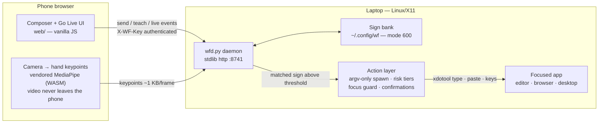
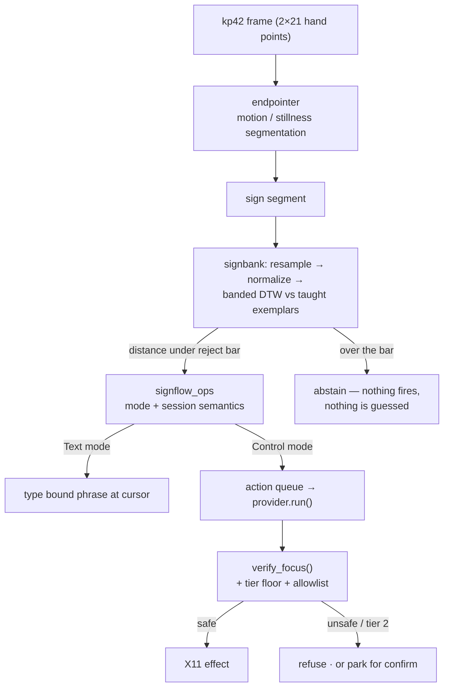

# Sign-Flow

Type and control your laptop without touching it.

Private, offline-first input for your laptop. Compose or sign on your phone; text, media, and actions land on the laptop over your own LAN.

- The phone browser composes text and attaches images, videos, and files — they are typed or pasted into the focused laptop window.
- Go Live turns the phone camera into a personal sign controller: teach a sign from a few takes, bind it to a laptop action or a phrase, and performing it fires the binding.
- Camera video never leaves the phone. The browser runs hand tracking locally and sends keypoint frames only.

The daemon is stdlib Python — zero dependencies, no build step, ~28 MB resident while idle ([proof](proofs/daemon-footprint/rss.txt)).

## Install and run

Requires Linux/X11 on the laptop and any modern browser on the phone.

```bash
git clone <this repo>
cd signflow
./bin/wrap start        # or: npm install && npm link && wrap start
```

`wrap start` detaches the daemon (its own session — it survives the terminal closing), prints the LAN URL, an ASCII QR, and the pairing code. Open the URL on the phone, tap to pair, and the composer is live. If the default port is taken the next free port is used and reported.

```bash
wrap status   # daemon state, pid, RSS, LAN URL
wrap logs     # daemon log
wrap stop     # clean shutdown
```

Verify the whole path on a fresh machine with `tools/smoke/fresh-clone.sh` — it clones into a temp dir, installs, starts the daemon, checks the LAN URL and the send/teach/live endpoints, and stops cleanly.

## Features

| Feature | How it works |
|---|---|
| Composer send | Text, image, video, file from the phone; typed at the cursor or pasted into the focused app |
| Go Live — Text | A performed sign types its bound phrase (e.g. "Hello") at the cursor |
| Go Live — Control | The same sign fires its bound laptop action — open an app, press keys, switch windows |
| Teach | Record 3 takes of your own sign; held-out verification confirms it before the sign goes live |
| Prefilled packs | One-tap ready signs: Hello, Namaste (listening pause), Introduce yourself |
| Laptop actions | `@` picker: apps, windows, workspaces, media, volume, screenshots, clipboard, chained steps — shown only while a laptop is connected |
| Focus guard | Type/key actions verify the focused window at fire time and refuse anything unsafe; an optional allowlist (`WF_TYPE_ALLOW`) pins them to designated windows |
| Confirm tiers | Destructive actions (e.g. close window) park for an explicit confirmation before running |

## Architecture



## Data flow



## Teach → perform → action (sequence)

```mermaid
sequenceDiagram
    participant U as user
    participant P as phone browser
    participant D as daemon
    participant X as laptop / X11
    U->>P: Teach → name + bind action → perform ×3
    P->>D: POST /teach/begin, /teach/take
    D->>D: exemplars → bank; held-out take verifies
    D-->>P: state: ready
    U->>P: perform the sign (Go Live)
    P->>D: POST /live/kp (keypoints only)
    D->>D: endpointer → DTW match
    alt Text mode
        D->>X: type the bound phrase at the cursor
    else Control mode
        D->>X: focus check → run the bound action
    end
    D-->>P: match + action result on the live feed
```

## Verification

Every claim below links to a recorded run or test.

| Claim | Proof |
|---|---|
| Fresh-clone install → daemon → endpoints work | `tools/smoke/fresh-clone.sh` — LAN URL 200, `/act`, `/live/state`, `/packs`, `/send` exercised, clean stop |
| Daemon survives terminal close, low footprint | setsid detach + reparenting verified; RSS in `proofs/daemon-footprint/rss.txt` |
| All Teach quick-action tiles run real OS effects | `proofs/ui-v2/act-tiles/RESULT.txt` — 22/22 on a real X11 desktop |
| Text types the label, Control fires the action | `proofs/ui-v2/mode-split/` — real 390×844 UI run |
| Air-written letters, browse cursor/scroll, live sign→action | `proofs/ui-v2/air/` — real X11 + Chrome windows |
| Teach flow through the shipped UI at 390×844 | `proofs/ui-v2/site-teach/` — 19/19 passes |
| Guarded typing refuses unsafe windows | `server/tests/test_act_quick.py` + the live `focus-refused` run |
| Sign matcher measured numbers | `BENCH.md` — honest table, including what is NOT MET |
| Unit suite | `cd server && python3 -m unittest discover -s tests` |

## Limitations

See `LIMITATIONS.md` for the full, current list. Headlines:

- The sign vocabulary is **personal and taught** — this is not a fixed sign-language recognizer. Recognition of a human hand on a real camera is not yet benchmarked; `BENCH.md` reports what is measured on synthetic motion.
- Laptop actions are X11-only; Wayland is detected and reported, not faked.
- Camera live mode needs a secure context on the phone (`wrap bridge` → `localhost`, or `wrap tunnel` → https) because browsers block `getUserMedia` on plain `http://<lan-ip>`.
- Type/key actions are focus-guarded; with no display or an unverifiable focus they refuse rather than type blind.

## Repository map

```
bin/wrap            CLI — start/stop/status/logs/pair/bridge/tunnel
server/wfd.py       daemon — http, pairing, send, teach, live, act
server/signbank.py  taught-sign bank — normalize + banded DTW + open-set reject
server/endpointer.py motion segmentation
server/signflow_ops.py session + mode semantics
server/act_iface.py action contract, tiers, focus guard
server/act_linux.py X11 provider (xdotool/wmctrl/xprop/ffmpeg fallbacks)
server/system_ctl.py system actions (media, volume, workspaces, dnd, …)
server/packs.py     prefilled teach packs
server/qrcodegen.py vendored QR generator (see Licenses)
server/tests/       unit + contract suite
web/                phone UI — composer, Go Live, Teach, settings (vanilla JS)
web/vendor/         vendored MediaPipe hand landmarker (offline, no CDN)
tools/smoke/        fresh-clone end-to-end smoke
tools/pro/          real-X11 proof drivers (act tiles, air letters, mode split)
tools/realrun/      realrun verification gate
proofs/             recorded runs — every claim links here
BENCH.md            measured numbers, including NOT MET rows
LIMITATIONS.md      honest current limits
```

## Licenses

All components are commercial-compatible:

| Component | License | File |
|---|---|---|
| Sign-Flow (this repo) | MIT | `LICENSE` |
| QR Code generator (vendored `server/qrcodegen.py`) | MIT — © Project Nayuki | header of the file |
| MediaPipe Tasks Vision + hand-landmarker model (vendored `web/vendor/mediapipe/`) | Apache-2.0 — © Google | `web/vendor/mediapipe/NOTICE.md` + `MANIFEST` |

No GPL/AGPL, non-commercial, or research-only licensed code ships in this tree.

## How to continue

- Real-camera recognition numbers are the open item — the matcher is measured on synthetic motion only (`BENCH.md`); a human-hand benchmark is the next honest gate.
- Wayland action support is unimplemented (detected + reported).
- The landing site lives on a sibling branch (`landing/` — static, deployable to Vercel/Cloudflare Pages).
