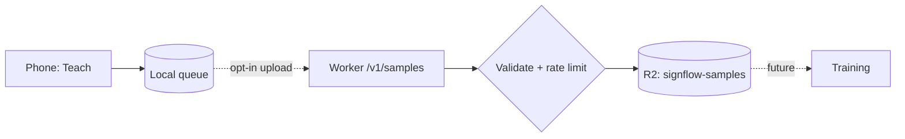

# signflow-contribute

Intake service for opt-in training samples. **Not deployed.** The app does not send anything to it in this release.

## API

`POST /v1/samples` with `content-type: application/json`:

```json
{
  "v": 1,
  "install": "0123456789abcdef0123456789abcdef",
  "gloss": "HELLO",
  "frames": [{ "t": 0, "p": [[0.51, 0.42, -0.02], "... 42 points"] }]
}
```

| Rule | Limit |
|---|---|
| Body size | 128 KB |
| Frames per sample | 2 to 64 |
| Points per frame | exactly 42, each `[x, y, z]`, numbers in -10..10 |
| Fields | only those above; any other field is rejected |
| Rate | 30 requests per minute per client |

Responses: `201` stored, `413` too large, `415` not JSON, `422` failed validation, `429` rate limited.

Valid samples are written to R2 under `v1/<date>/<gloss>/<uuid>.json`. The client IP is used only as the rate-limit key and is not stored.



## Develop

```sh
npm install
npm run check     # type check
npm test          # schema tests
npx wrangler dev  # local, with a simulated R2 bucket
```

`wrangler.toml` holds placeholder names only. Before a deploy you would create your own R2 bucket, set its name, and log in with `wrangler login`. Never commit account ids or tokens.

The app reads its upload address from `SIGNFLOW_CONTRIBUTE_URL` on the laptop. It is empty by default, and with it empty the app sends nothing.
