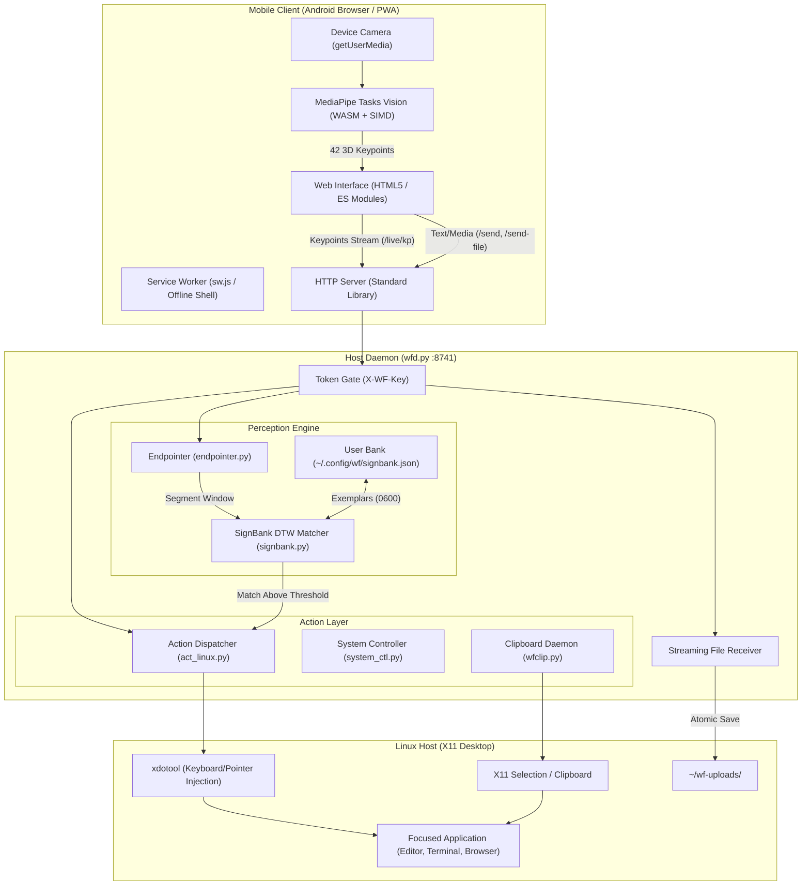

# Sign-Flow Architecture

## 1. System Overview

Sign-Flow provides an out-of-band input bridge connecting an Android smartphone to a Linux desktop environment running X11. It operates across two primary interaction layers:

1. **Text and Media Composer**: Direct dictation, typed text, images, and files sent from a mobile browser into the active cursor position or clipboard of the Linux desktop.
2. **Gesture Recognition Engine**: Real-time hand tracking executed inside the mobile browser via WebAssembly, streaming normalized landmarks over local HTTP to an on-device Dynamic Time Warping (DTW) gesture classifier that dispatches operating system actions.

The architecture requires no cloud services, external accounts, or external network connectivity. All inference, networking, and dispatch remain strictly local to the local area network or USB connection.

---

## 2. High-Level Architecture Diagram

---

## 3. Communication Protocols and Endpoints

Communication between the mobile client and host daemon uses HTTP/1.1 with JSON payloads, multipart uploads, or raw byte streams. Authentication is enforced via the `X-WF-Key` HTTP header.

### 3.1 Network Transports
- **Local Wi-Fi (LAN)**: Host binds to `0.0.0.0:8741`. The pairing card displays the active LAN IPv4 address (e.g., `http://192.168.1.50:8741/?k=<key>`).
- **USB Tethering (ADB Reverse)**: Port forwarding via `adb reverse tcp:8741 tcp:8741` exposes the daemon at `http://localhost:8741` on the Android device, satisfying browser secure context requirements for camera access without SSL configuration.
- **Encrypted Remote Tunnel**: Optional `cloudflared` tunnel exposing a public `https://*.trycloudflare.com` URL while keeping execution local.

### 3.2 Key HTTP Endpoints

| Method | Path | Authentication | Payload | Description |
|---|---|---|---|---|
| `GET` | `/health` | None | None | Service liveness probe (`{"ok": true, "service": "wispr-wrap"}`) |
| `GET` | `/pair-info` | Loopback / Authed | None | Returns LAN IP, port, active key, and pairing code |
| `POST` | `/pair` | Code / Key | `{"code": "..."}` | Validates 8-character pairing code; returns session key |
| `POST` | `/send` | `X-WF-Key` | `{"text": "...", "mode": "type"\|"paste"}` | Injects text into the focused X11 window |
| `POST` | `/send-image` | `X-WF-Key` | Image Binary | Copies image to X11 clipboard via `wfclip.py` |
| `POST` | `/send-file` | `X-WF-Key` | File Stream | Streams file to `~/wf-uploads/` with 1 MiB chunking |
| `POST` | `/live/kp` | `X-WF-Key` | `{"session": "...", "points": [...]}` | Ingests 42-point hand keypoints frame |
| `GET` | `/live/state` | `X-WF-Key` | None | Returns current listening mode, last match, and DTW state |
| `POST` | `/live/listen` | `X-WF-Key` | `{"listening": true\|false}` | Toggles gesture listening state |
| `POST` | `/live/mode` | `X-WF-Key` | `{"mode": "live"\|"observe"}` | Sets Live (Control) or Observe (Text) mode |
| `POST` | `/teach/begin` | `X-WF-Key` | `{"gloss": "...", "action": {...}}` | Starts 3-take recording session for a new sign |
| `POST` | `/teach/end` | `X-WF-Key` | `{"save": true\|false}` | Concludes recording and commits exemplars |
| `GET` | `/bank` | `X-WF-Key` | None | Lists all enrolled gestures and bound actions |
| `PUT` | `/bank` | `X-WF-Key` | `{"gloss": "...", "action": {...}}` | Updates action binding for an existing sign |
| `DELETE` | `/bank` | `X-WF-Key` | Query `?gloss=...` | Removes a sign and its exemplars from the bank |
| `GET` | `/act` | `X-WF-Key` | None | Catalog of available system apps and tools |

---

## 4. Perception and Gesture Matching Subsystem

### 4.1 Client-Side Pose Estimation
Hand landmark extraction runs fully inside the phone browser:
- **Runtime**: MediaPipe Tasks Vision WebAssembly engine (`vision_bundle.mjs` + `vision_wasm_internal.wasm`).
- **Model**: `hand_landmarker.task` (~7.5 MB float16 model).
- **Coordinate System**: Emits 21 3D landmarks per hand (42 landmarks total):
  - Indices 0–20: Left hand landmarks.
  - Indices 21–41: Right hand landmarks.
  - Normalized image coordinates $[0, 1]$ along $X$ and $Y$; relative depth along $Z$.
  - Absent hands report coordinates with confidence score `0.0`.

### 4.2 Endpointer (`server/endpointer.py`)
The endpointer ingests continuous landmark streams and segments deliberate gestures from background movement:
- Calculates palm motion energy using velocity hysteresis (`enter_v` and `exit_v`).
- Detects presentation poses:
  - **Open Palm**: Triggers the `PALM-OPEN` event to transition into listening mode.
  - **Namaste (Palms Together)**: Triggers the `NAMASTE` event to pause listening.
- Applies quiet-time thresholds (`quiet_s = 0.35 s`) to delineate segment boundaries.
- Emits isolated segment windows to the DTW matcher.

### 4.3 SignBank DTW Matcher (`server/signbank.py`)
- Employs Dynamic Time Warping (DTW) with a banded constraint (Sakoe-Chiba band width = 4).
- Matches input segments against user-taught exemplars stored in `~/.config/wf/signbank.json`.
- Dual-channel distance metric:
  1. **Trajectory Channel**: Hand path displacement resampled to 32 uniform temporal points.
  2. **Hand Shape Channel**: Median 21-point hand posture across the segment.
- Fused distance score compared against calibrated rejection thresholds (default threshold = 0.6).
- If matched, the bound action dispatches; if distance exceeds threshold, the motion is rejected without false execution.

---

## 5. Action Dispatch and Security Architecture

### 5.1 Security Model
- **Token Gating**: All control endpoints require `X-WF-Key`. The 32-character hexadecimal key is stored at `~/.config/wf/key` with strict `0600` POSIX permissions.
- **Request Body Limits**: Enforced prior to reading payloads into memory:
  - Control endpoints (`/live/*`, `/teach/*`): 16 KiB limit.
  - Image uploads (`/send-image`): 64 MiB limit (`WF_MAX_IMAGE`).
  - File streaming (`/send-file`): 512 MiB limit (`WF_MAX_UPLOAD`).
- **Disk Protection**: The file streamer verifies available filesystem storage before writing and purges incomplete files upon client disconnect.
- **Argv-Only Execution**: System commands execute strictly via explicit argument vectors (`subprocess.run(["xdotool", ...])`), completely bypassing shell parsing (`shell=False`) to prevent command injection.

### 5.2 Window Focus Verification
To avoid typing or dispatching actions into unintended applications, `/send` and `act_linux.py` support window class verification (`expect` parameter). If the target window loses focus before dispatch, the daemon refuses execution with HTTP 409, preventing accidental input leakage.
